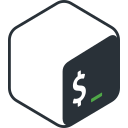

# Hi, I'm Isabella 👋

**Platform & infrastructure engineer** · AWS · Kubernetes · regulated environments
📍 Pretoria, South Africa 🇿🇦

I've spent thirty years keeping mission-critical systems running, and my career runs from C on Solaris to Kubernetes on AWS. These days I build and run multi-account AWS platforms on EKS and ECS for clients who need ISO 27001, POPIA and GDPR. I'm happiest in hands-on work that spans backend services and the infrastructure underneath them.

### 🛠️ What I work on

- ☁️ **Multi-account AWS estates** on EKS and ECS, including multi-tenant clusters with strict separation between clients
- 🔁 **GitOps and CI/CD** with ArgoCD, CodePipeline and CodeBuild, from commit to running container
- 🔐 **Security by default**: least-privilege IAM, recurring security reviews and penetration testing
- 📋 **Compliance that passes audit**: ISO 27001, POPIA and GDPR, with the governance documentation to back it up
- 💸 **Cost as an engineering discipline**: right-sizing against real usage data, not a once-a-year clean-up
- 🤖 **AI-assisted engineering**: I use AI every day, and its output gets verified before it ships

### 🧰 Toolbox

  &nbsp;&nbsp;
  &nbsp;&nbsp;
  &nbsp;&nbsp;
  &nbsp;&nbsp;
  &nbsp;&nbsp;
  &nbsp;&nbsp;

  &nbsp;&nbsp;
  &nbsp;&nbsp;
  &nbsp;&nbsp;
  &nbsp;&nbsp;

  &nbsp;&nbsp;
  &nbsp;&nbsp;
  &nbsp;&nbsp;
  &nbsp;&nbsp;
  &nbsp;&nbsp;
  &nbsp;&nbsp;
  &nbsp;&nbsp;

  &nbsp;&nbsp;
  &nbsp;&nbsp;
  &nbsp;&nbsp;
  &nbsp;&nbsp;
  &nbsp;&nbsp;
  &nbsp;&nbsp;
  &nbsp;&nbsp;
  &nbsp;&nbsp;
  &nbsp;&nbsp;
  &nbsp;&nbsp;

  &nbsp;&nbsp;
  &nbsp;&nbsp;

| | |
|---|---|
| ☁️ **AWS** | EKS, ECS, EC2, ECR, RDS (PostgreSQL), S3, IAM, Route 53, ACM, SES, SQS, CloudFront, API Gateway, ElastiCache/Redis |
| 📦 **Containers** | EKS and ECS in production, multi-tenant cluster operation, resource limits and right-sizing, Docker |
| 🚀 **CI/CD** | ArgoCD (pull-based GitOps), CodePipeline, CodeBuild, ECR image tagging and promotion, Slack release notifications |
| 🔐 **Security & compliance** | Security reviews, penetration testing, least-privilege IAM, ISO 27001, POPIA, GDPR |
| 📈 **Observability** | CloudWatch, Prometheus, Grafana, CloudTrail, Cost & Usage Report |
| 🐧 **Systems & networking** | Linux and Unix (Solaris, and OpenVMS once upon a time), DNS, TLS, networking, Bash |
| 🗄️ **Databases** | PostgreSQL, MySQL, Oracle, Ingres, Informix, Sybase · Prisma, TypeORM, SQLAlchemy |
| 💻 **Languages & backend** | TypeScript (NestJS, Next.js), Python (FastAPI), C/C++, PL/SQL, Perl, Bash · REST/OpenAPI |
| 🤖 **AI tools** | Claude, GitHub Copilot |
